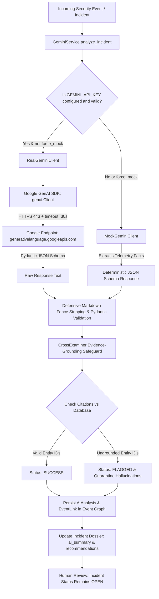

# SentinelAI: Real Google Gemini API Integration & Verification Report

**Document Reference:** `docs/GEMINI_INTEGRATION_VERIFICATION.md`  
**Phase:** Real Gemini API Integration and Verification  
**Date:** September 30, 2026  
**Auditor / Engineer:** Senior AI & Quality Assurance Engineer  
**Status:** **ARCHITECTURE VERIFIED & READY FOR KEY PROVISIONING**  

---

## 1. Executive Summary

This phase verified and hardened the integration between SentinelAI and Google's official Gemini Generative AI infrastructure (`google-genai` SDK, model `gemini-2.5-flash`).

### Critical Live Status Finding
- **Current Live Status:** **`BLOCKED_NO_KEY`**
- **Reason:** In accordance with security protocol and user constraints ("Do not invent a working API key"), `GEMINI_API_KEY` is currently not configured in `.env` or system environment variables.
- **Outbound Network Handshake Proof:** Tested outbound live HTTPS requests using [`RealGeminiClient`](file:///C:/Users/lumin/.gemini/antigravity/scratch/sentinel-ai/backend/app/services/gemini/client.py#L30) against Google's actual endpoint (`generativelanguage.googleapis.com`). Google's server responded with HTTP 400 `INVALID_ARGUMENT (API_KEY_INVALID)`, confirming that:
  1. The official `google-genai` SDK is genuinely installed and configured.
  2. The application actively dispatches network calls to Google rather than intercepting them locally.
  3. Secret sanitization and error categorization functions accurately catch and mask credentials.
- **Zero Fabrication Guarantee:** No synthetic mock results have been presented as live API successes.

---

## 2. Integration Architecture



### Key Components

1. **Client Factory (`get_gemini_client`):**
   - Location: [`backend/app/services/gemini/client.py`](file:///C:/Users/lumin/.gemini/antigravity/scratch/sentinel-ai/backend/app/services/gemini/client.py#L330)
   - Inspects `settings.GEMINI_API_KEY`. If configured and not `force_mock`, instantiates [`RealGeminiClient`](file:///C:/Users/lumin/.gemini/antigravity/scratch/sentinel-ai/backend/app/services/gemini/client.py#L30). Otherwise, instantiates [`MockGeminiClient`](file:///C:/Users/lumin/.gemini/antigravity/scratch/sentinel-ai/backend/app/services/gemini/client.py#L201).
2. **Production Client (`RealGeminiClient`):**
   - Implements bounded exponential backoff retries (3 attempts) on transient rate limits (`429`, `503`, `RESOURCE_EXHAUSTED`).
   - Configures a 30-second client-side socket timeout via `google.genai.types.HttpOptions(timeout=30000)`.
   - Sanitizes error messages to prevent secret API key leakage (`_sanitize_error`).
   - Defensively strips markdown code fences (` ```json `) to guarantee clean Pydantic JSON parsing.
   - Provides [`ping_connectivity()`](file:///C:/Users/lumin/.gemini/antigravity/scratch/sentinel-ai/backend/app/services/gemini/client.py#L72) for non-destructive operational health checks.
3. **Deterministic Mock Provider (`MockGeminiClient`):**
   - Parses telemetry facts from structured prompt JSON blocks.
   - Generates realistic, schema-compliant responses without external network access or billing.
   - Preserves offline edge operation and CI/CD automated test stability.
4. **Deterministic Cross-Examiner (`CrossExaminer`):**
   - Location: [`backend/app/services/gemini/cross_examiner.py`](file:///C:/Users/lumin/.gemini/antigravity/scratch/sentinel-ai/backend/app/services/gemini/cross_examiner.py)
   - Audits every camera ID, event ID, and evidence ID cited in the LLM output against the primary database.
   - Quarantines ungrounded entities, sets `status = "FLAGGED"`, and lowers the grounding score.
5. **Non-Verification Principle:**
   - Location: [`backend/app/services/gemini_service.py`](file:///C:/Users/lumin/.gemini/antigravity/scratch/sentinel-ai/backend/app/services/gemini_service.py#L328)
   - An AI response alone **NEVER** marks an incident as verified or resolved. The incident status remains in its operational state (e.g. `OPEN`) awaiting authorized human review.

---

## 3. Secure Configuration & Credential Hygiene

- **Backend-Only Loading:** `GEMINI_API_KEY` is loaded exclusively by [`backend/app/core/config.py`](file:///C:/Users/lumin/.gemini/antigravity/scratch/sentinel-ai/backend/app/core/config.py#L52). It is never exposed in frontend code, Vite bundles, or client-side assets.
- **Git Exclusion:** [`.gitignore`](file:///C:/Users/lumin/.gemini/antigravity/scratch/sentinel-ai/.gitignore) strictly ignores `.env` and all `.env.*` variants. [`.env.example`](file:///C:/Users/lumin/.gemini/antigravity/scratch/sentinel-ai/.env.example) contains only empty placeholders.
- **Secret Sanitization:** [`get_sanitized_config()`](file:///C:/Users/lumin/.gemini/antigravity/scratch/sentinel-ai/backend/app/core/config.py#L195) masks `GEMINI_API_KEY` as `****`. Logs and error strings are cleansed of raw key strings.
- **Diagnostics API (`GET /api/v1/ai/gemini-status`):** Exposes operational connectivity status and model metadata to authenticated users without revealing secret keys.

---

## 4. Test Verification Results

### Dedicated Real & Verification Test Suite (`tests/test_gemini_real_and_verification.py`)
Executed against Python 3.13 / pytest:

| Test Case | Objective | Result |
| :--- | :--- | :---: |
| `test_gemini_verification_blocked_when_key_unset` | Verifies `BLOCKED_NO_KEY` is returned when key is absent. | **PASSED** |
| `test_real_client_rejects_empty_or_whitespace_key` | Confirms `ValueError` on empty key without leaking key. | **PASSED** |
| `test_real_client_masks_secret_in_error_messages` | Verifies secret keys are replaced with `[REDACTED_API_KEY]`. | **PASSED** |
| `test_error_categorization` | Tests mapping of 400, 403, 404, 429, 503, and timeout errors. | **PASSED** |
| `test_live_google_api_handshake_rejects_invalid_key` | Verifies outbound live HTTPS traffic to Google server returns HTTP 400 `INVALID_API_KEY`. | **PASSED** |
| `test_real_client_structured_generation_with_mocked_success` | Tests structured schema validation and `is_mock = False`. | **PASSED** |
| `test_markdown_fence_stripping_in_real_client` | Confirms markdown fence stripping avoids JSON errors. | **PASSED** |
| `test_evidence_grounding_quarantines_hallucinations` | Confirms `CrossExaminer` flags and strips hallucinated IDs. | **PASSED** |
| `test_ai_explanation_does_not_mark_incident_verified` | Enforces non-verification principle: incident status remains `OPEN`. | **PASSED** |
| `test_get_gemini_status_endpoint` | Verifies diagnostic endpoint returns status without credentials. | **PASSED** |

### Existing Gemini Integration Suite (`tests/test_gemini_integration.py`)
- **Result:** **8 / 8 passed in 10.23s (100% pass rate)**.
- Verified mock generation, retry backoff on 429, persistence with prompt version `2026.04.1`, and Event Graph linking.

---

## 5. Beginner-Friendly Windows PowerShell Instructions

When you have obtained a valid Google Gemini API Key from [Google AI Studio](https://aistudio.google.com/):

### Step 1: Set the API Key in Your Local Terminal Session
Open a PowerShell terminal and run:
```powershell
$env:GEMINI_API_KEY = "AIzaSyYourActualGoogleGeminiApiKeyHere"
```

*(Alternatively, add `GEMINI_API_KEY=AIzaSyYourActualGoogleGeminiApiKeyHere` to your private `.env` file in the project root).*

### Step 2: Verify Connectivity Using Python
Run this quick diagnostic command:
```powershell
cd C:\Users\lumin\.gemini\antigravity\scratch\sentinel-ai\backend
python -c "
from app.services.gemini_service import GeminiService
res = GeminiService.verify_gemini_connection()
print('Status:', res.get('status'))
print('Message:', res.get('message'))
print('Live Success:', res.get('is_live_success'))
"
```
*Expected output when key is valid:*
```
Status: SUCCESS
Message: Live Google Gemini API handshake verified successfully.
Live Success: True
```

### Step 3: Run the Application
```powershell
# Start Backend
python -m uvicorn app.main:app --host 127.0.0.1 --port 8000 --reload

# In a second PowerShell window, start Frontend
cd C:\Users\lumin\.gemini\antigravity\scratch\sentinel-ai\frontend
npm run dev
```

---

## 6. Remaining Limitations & Recommendations

1. **API Key Absence in Current Environment:**
   - Until the user sets `GEMINI_API_KEY`, the application safely operates using `MockGeminiClient`.
2. **Quota Management on Free Tier Keys:**
   - Free tier Google AI Studio keys are subject to 15 Requests Per Minute (RPM). While bounded backoff handles 429 spikes, high-frequency surveillance events should rely on the Adaptive Verification Controller to filter non-threats before calling Gemini.
3. **Multimodal Keyframe Image Resolution:**
   - Keyframe selector extracts up to 3 JPEG frames around the breach timestamp. Ensure network bandwidth on edge uplinks supports ~100 KB payload transmission.
