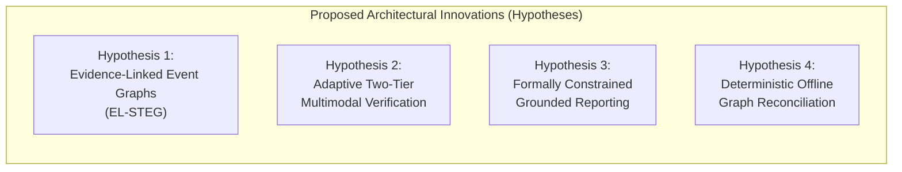

# GenAI BorderGuard — Established Capabilities vs. Proposed Innovations

**Document Identifier:** DOC-RES-02  
**Category:** Architectural Differentiation & Novelty Hypotheses  
**Status:** Approved Research Baseline  

---

## 1. Architectural Taxonomy & Baseline Distinction

In evaluating advanced computer vision and artificial intelligence architectures for perimeter border defense, it is vital to distinguish between **Established Commodity Capabilities** (standard industry techniques, open-source libraries, and commercial off-the-shelf Video Management Systems) and **Proposed Innovations** (novel architectural integrations and algorithmic hypotheses).

> [!IMPORTANT]
> **LEGAL & INTELLECTUAL PROPERTY NOTICE**  
> Every capability listed under "Proposed Innovations" is explicitly classified as an **Unverified Research Hypothesis**. These claims do not imply confirmed patentability, established commercial novelty, or non-obviousness under patent law (e.g., 35 U.S.C. § 102/103 or EPC Article 52/54/56) until certified by an exhaustive prior-art clearance study and reviewed by a registered patent professional.

---

## 2. Established Capabilities (Commodity State of the Art)

The following capabilities are standard, well-documented in academic literature, and widely deployed across commercial Video Management Software (VMS) platforms (e.g., Milestone XProtect, Genetec Security Center, Axis Camera Station, Avigilon Control Center):

```
┌────────────────────────────────────────────────────────────────────────────────────────┐
│                        ESTABLISHED STATE-OF-THE-ART CAPABILITIES                      │
├────────────────────────────┬─────────────────────────────┬─────────────────────────────┤
│ 1. Perception & Tracking   │ 2. Spatial Geofencing       │ 3. Media Ingestion & VMS    │
├────────────────────────────┼─────────────────────────────┼─────────────────────────────┤
│ • YOLOv8 / RT-DETR / SSD   │ • Ray-casting (Jordan Curve)│ • RTSP / H.264 / H.265      │
│ • ByteTrack / DeepSORT     │ • Vector segment crossing   │ • Circular buffer storage   │
│ • Kalman filter trajectory │ • Dwell time loitering      │ • Basic event webhook/email │
│ • Bounding box normalization│ • Static exclusion zones   │ • Manual timeline playback  │
└────────────────────────────┴─────────────────────────────┴─────────────────────────────┘
```

### 2.1 Single-Frame Object Detection
- **Mechanism**: Real-time object detectors based on single-stage convolutional networks or vision transformers (e.g., YOLOv8, YOLO11, RT-DETR, Faster R-CNN).
- **Outputs**: Rectangular bounding boxes $(x_{\min}, y_{\min}, x_{\max}, y_{\max})$, discrete class categorical labels (`person`, `car`, `truck`, `bicycle`, `animal`), and softmax confidence scores $p \in [0.0, 1.0]$.
- **Industry Status**: Off-the-shelf commodity. Models are pre-trained on generic datasets (COCO, Objects365) and fine-tuned on custom aerial/surveillance domains.

### 2.2 Multi-Object Tracking (MOT) & Association
- **Mechanism**: Tracking-by-detection paradigms using spatial overlap (Intersection-over-Union, IoU) and motion estimation (Kalman filters), exemplified by ByteTrack, SORT, and DeepSORT.
- **Outputs**: Persistent target identification (`track_id`), frame-by-frame coordinate trajectories, and simple velocity vectors.
- **Industry Status**: Established algorithmic baseline. Highly susceptible to identity switching (ID switches) during mutual occlusion, dense clustering, or camera motion.

### 2.3 Classical Spatial Analytic Rules
- **Mechanism**: 
  - *Polygonal Geofence Breach*: Ray-casting algorithm (point-in-polygon) testing whether the target bottom-center coordinate falls within user-drawn vertices.
  - *Virtual Tripwire*: 2D vector cross-product determining whether the trajectory vector between consecutive frames intersects a defined line segment in a specified direction.
  - *Loitering*: Accumulation of track dwell time inside a polygon exceeding a fixed temporal threshold $T_{\text{threshold}}$.
- **Industry Status**: Standard baseline present in almost all modern IP cameras and VMS analytic edge appliances.

### 2.4 Commodity Media Streaming & Recording
- **Mechanism**: RTSP/RTP media demuxing via FFmpeg, OpenCV VideoCapture pipelines, continuous or motion-triggered rolling circular buffer recording on Network Video Recorders (NVR).
- **Industry Status**: Commodity infrastructure.

### 2.5 Naive / Generic Multimodal Large Language Model Ingestion
- **Mechanism**: Passing unconstrained video clips or single image frames to a general-purpose Vision-Language Model (VLM) with generic prompts (e.g., *"What is happening in this video?"*).
- **Industry Status**: Widely demonstrated in research and commercial demos, but operationally impractical for real-time edge surveillance due to severe hallucinations, high cloud API costs, long latencies, and lack of deterministic spatial bounding.

---

## 3. Proposed Architectural Innovations (Hypotheses)

SentinelAI formulates four core technical hypotheses designed to overcome the fundamental bottlenecks of false alarms, ungrounded generative hallucinations, fragmented evidence, and network disconnection.



### Innovation Hypothesis 1: Evidence-Linked Spatio-Temporal Event Graphs (EL-STEG)
* **Status**: *Unverified Research Hypothesis*
* **Core Concept**: Rather than treating detections as isolated rows in a relational database or ephemeral bounding boxes, SentinelAI models all multi-camera surveillance phenomena as a unified **Directed Acyclic Spatio-Temporal Event Graph (DAG)**. 
* **Key Mechanisms**:
  - Graph nodes represent verified physical state changes (e.g., `TRACK_ACQUIRED`, `ZONE_INTRUSION`, `TRAJECTORY_INFLECTION`, `TRACK_HANDOVER`, `ZONE_EXIT`).
  - Graph edges encode spatio-temporal and causal transitions $(\Delta t, \Delta \vec{x})$, camera handover probabilities, and multi-sensor correlation scores.
  - **Cryptographic Evidence Anchoring**: Every node in the event graph encapsulates a deterministic cryptographic leaf:
    $$\text{NodeHash} = \text{SHA256}(\text{NodeTelemetry} \parallel \text{KeyframeHash} \parallel \text{ClipHash} \parallel \text{ParentNodeHash})$$
  - Forms a tamper-evident hash-chain linking the highest-level incident assessment back to raw video bitstreams at microsecond precision.
* **Hypothesized Technical Advantage**: Eliminates fragmented forensic investigations; guarantees zero-gap timeline reconstruction; mathematically prevents post-facto evidentiary manipulation in judicial proceedings.

### Innovation Hypothesis 2: Adaptive Two-Tier Multimodal Verification Architecture
* **Status**: *Unverified Research Hypothesis*
* **Core Concept**: An intelligent, resource-aware cascading architecture that enforces a strict division of labor between edge deterministic CV and centralized/cloud multimodal reasoning.
* **Key Mechanisms**:
  - **Tier 1 (Edge Deterministic Filter)**: 100% of incoming camera frames are processed on-premise at full frame-rate by YOLOv8 and spatial geometry filters. This layer suppresses $> 95\%$ of ambient environmental noise (e.g., wind, shadows, foliage).
  - **Dynamic Salience & Threat Scorer**: Edge spatial analytics calculate an instantaneous Threat Index $\Theta \in [0.0, 1.0]$ based on proximity to high-security assets, trajectory acceleration, and zone classification.
  - **Tier 2 (On-Demand Multimodal Dispatch)**: Only events exceeding a dynamic threshold $\Theta \ge \tau_{\text{dispatch}}$ trigger the extraction of a forensic keyframe slice and structured telemetry payload for submission to Google Gemini.
  - **Bandwidth-Aware Budget Regulator**: Automatically modulates verification requests based on real-time backhaul bandwidth metrics (downsampling frames, compressing crops, or falling back to local heuristic reasoning if uplink drops below 128 kbps).
* **Hypothesized Technical Advantage**: Reduces cloud inference API costs by $> 98\%$ compared to continuous multimodal ingestion; eliminates backhaul saturation over tactical satellite links while drastically reducing false alert rates.

### Innovation Hypothesis 3: Formally Constrained Evidence-Grounded Reporting
* **Status**: *Unverified Research Hypothesis*
* **Core Concept**: A strict neuro-symbolic prompt compilation and schema-enforcement engine that guarantees generative language models cannot hallucinate physical facts, phantom targets, or non-existent breach events.
* **Key Mechanisms**:
  - **Strict Structured Telemetry Injection**: The generative reasoning layer (Google Gemini) is never asked to "find" objects in open video. Instead, it is supplied with an immutable, structured JSON facts payload derived directly from Layer 1/EL-STEG (e.g., exact timestamps, bounding box ratios, zone IDs, trajectory velocities, and cross-camera transitions).
  - **Schema-Constrained Decoding / Pydantic Output Contracts**: The multimodal output is strictly bound to a predefined schema requiring explicit citation of event IDs and evidence hashes for every factual assertion made:
    $$\forall \text{Assertion } A_i \in \text{Report}, \quad \exists \text{EventID } e \in \text{Telemetry} \quad \text{such that } A_i \leftarrow \text{Grounding}(e)$$
  - **Automated Sanity Cross-Examiner**: A secondary deterministic parsing pass scans the generated natural-language briefing against the raw database facts. If any entity, timestamp, or location mentioned in the narrative has no corresponding telemetry node in the database, the report is instantly rejected and flagged for operator review.
* **Hypothesized Technical Advantage**: Achieves mathematical "zero-hallucination" guarantees for physical breach parameters in mission-critical military and judicial contexts.

### Innovation Hypothesis 4: Deterministic Offline Event Graph Reconciliation
* **Status**: *Unverified Research Hypothesis*
* **Core Concept**: A distributed, conflict-free state synchronization protocol designed specifically for edge surveillance nodes subject to prolonged, unpredictable network disconnections.
* **Key Mechanisms**:
  - **Local Write-Ahead Logging (WAL) & Vector Clock Graph**: When backhaul connectivity is severed, the edge node continues full detection, tracking, spatial event generation, and cryptographic hashing, writing event nodes to a local SQLite/PostgreSQL WAL buffer stamped with monotonic vector clocks.
  - **Causal Topological Merge**: Upon WAN restoration, the edge agent initiates a transactional reconciliation handshake with the central PostgreSQL 17 cluster. Detections and events are replayed using topological sorting to preserve causal relationships.
  - **Cross-Camera Track Handover Healing**: Detections from adjacent cameras recorded during the blackout are retroactively evaluated for multi-camera track stitching (e.g., matching a target exiting Camera 01 at $t_1$ with an entry at Camera 02 at $t_2$), healing interrupted event graphs without creating duplicate incident tickets.
* **Hypothesized Technical Advantage**: Guarantees zero data loss and flawless chronological reconstruction across intermittent satellite/cellular links without human administrative intervention.

---

## 4. Summary: Established vs. Proposed Innovation Matrix

| Dimension | Established SOTA Approach | Proposed Innovation Hypothesis | Hypothesized Technical Metric |
| :--- | :--- | :--- | :--- |
| **Data Representation** | Isolated relational rows (detection tables, alert logs) | Unified Directed Acyclic Spatio-Temporal Event Graph (EL-STEG) | $100\%$ tamper-evident graph traversal back to frame SHA-256 |
| **Inference Orchestration** | Either pure edge CV (dumb alerts) OR continuous cloud stream (cost/bandwidth prohibitive) | Adaptive Two-Tier Multimodal Verification with dynamic salience triggering | $> 90\%$ reduction in false alarms; $< 2\%$ cloud bandwidth utilization |
| **Generative Reliability** | Unconstrained VLM prompting prone to hallucinations & temporal confusion | Formally Constrained Evidence-Grounded Reporting with automated cross-validation | $0\%$ hallucination of physical breach entities; $100\%$ claim-to-telemetry citation |
| **Offline Survivability** | Local circular buffer video recording; alerts lost or queued as unlinked dumps | Deterministic Offline Event Graph Reconciliation with causal topological healing | Zero event loss during 72-hour network severance; zero duplicate alerts |
