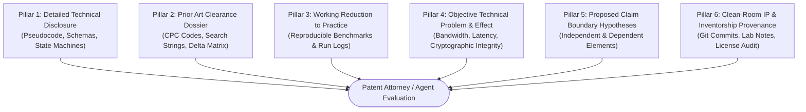

# GenAI BorderGuard — Patentability Evidence Readiness & Legal Disclosure Guidelines

**Document Identifier:** DOC-RES-07  
**Category:** Intellectual Property Readiness & Technical Disclosure Protocol  
**Status:** Approved Research Baseline  

---

## 1. Legal Context & Statutory Patentability Criteria

When seeking to protect software-implemented inventions in computer vision and artificial intelligence, inventors face stringent statutory hurdles across major jurisdictions (notably the United States Patent and Trademark Office [USPTO] and the European Patent Office [EPO]).

```
┌────────────────────────────────────────────────────────────────────────────────────────┐
│                        STATUTORY PATENTABILITY HURDLES FOR AI/CV                       │
├───────────────────────────────────────────┬────────────────────────────────────────────┤
│ UNITED STATES (USPTO / 35 U.S.C.)         │ EUROPE (EPO / EPC ARTICLES 52 & 56)        │
├───────────────────────────────────────────┼────────────────────────────────────────────┤
│ • 35 U.S.C. § 101 (Patent Eligibility)    │ • Article 52(2)(c) & (3)                   │
│   - Must survive Alice/Mayo two-step test  │   - Computer programs "as such" excluded   │
│   - Cannot claim an "abstract idea"       │ • "Problem-and-Solution Approach"          │
│   - Must improve computer/system function │   - Must solve an Objective Technical      │
│ • 35 U.S.C. § 102 / 103                   │     Problem (OTP)                          │
│   - Novelty and Non-Obviousness           │   - Must produce a "Technical Effect"      │
│ • 35 U.S.C. § 112 (Enablement & Written   │ • Article 83 (Sufficiency of Disclosure)   │
│   Description)                            │   - Must be reproducible by a PHOSITA      │
└───────────────────────────────────────────┴────────────────────────────────────────────┘
```

> [!WARNING]
> **NO GUARANTEE OF PATENTABILITY**  
> Under no circumstances does this document, or the existence of novel architectural features, guarantee that a patent will issue or is even patent-eligible. Inventions involving software, machine learning, and data structures are scrutinized heavily under the *Alice Corp. v. CLS Bank* doctrine (USPTO) and Technical Character tests (EPO). Only a licensed, registered patent attorney or patent agent can evaluate patentability and draft enforceable claims.

---

## 2. The Six Essential Evidentiary Pillars

Before a patent professional can render an informed opinion regarding patentability or prepare a non-provisional patent application, engineering teams must supply the following **Six Evidentiary Pillars**:



### Pillar 1: Exhaustive Technical Embodiment & Algorithmic Blueprint
Patent examiners reject vague functional descriptions (e.g., *"a system that uses AI to detect border intrusions and summarize them without hallucination"*). The disclosure must provide concrete structural and algorithmic blueprints:
- **Exact Data Structures**: Formal schemas for the Directed Acyclic Graph ($\mathcal{G} = (\mathcal{V}, \mathcal{E}, \mathcal{H})$), vector clock formats, and JSON telemetry contracts.
- **Algorithmic Flowcharts & Pseudocode**: Step-by-step logic for the ray-casting spatial evaluator, dynamic threat score calculator ($\Theta(t)$), automated cross-examiner parsing engine, and topological reconciliation merge sort.
- **Hardware Integration Details**: Concrete specifications of edge sensors (RTSP IP cameras), compute nodes (embedded GPU/SoC), and the communication bus (WebSockets, REST endpoints, TLS 1.3).

### Pillar 2: Exhaustive Prior-Art Clearance Dossier
The patent attorney must be equipped with comprehensive discovery records:
- **Search Transcripts**: Complete logs of queries run on USPTO PPUBS, Espacenet, and Google Patents (as outlined in `03_prior_art_investigation_checklist.md`).
- **Closest Prior-Art Publications**: Full-text PDFs of the closest 3–5 commercial patents (e.g., Anduril, Palantir, BriefCam) and academic papers (e.g., cascaded video analytics, video scene graphs).
- **Novelty Delta Matrix**: A precise clause-by-clause comparative analysis stating exactly what each prior-art reference teaches, where it falls short, and how the proposed embodiment structurally differs.

### Pillar 3: Concrete Reduction to Practice & Empirical Benchmark Logs
Under 35 U.S.C. § 112 (Enablement), an invention must be described with sufficient clarity to enable a Person Having Ordinary Skill in the Art (PHOSITA) to build and operate the system without undue experimentation:
- **Working Code Prototype**: A functional, reproducible implementation running within Docker containers.
- **Laboratory Benchmark Telemetry**: Raw test logs, execution profiling, and benchmark datasets proving the claimed technical effect (e.g., actual False Alarm Rate drops, latency measurements, and zero-hallucination verification scores).
- **Comparative Baseline Results**: Side-by-side data showing that the proposed mechanism outperforms the conventional baseline under identical testing parameters.

### Pillar 4: Objective Technical Problem (OTP) & Technical Effect Documentation
To survive USPTO § 101 and EPO Article 52 exclusions against abstract ideas, the invention must be framed around **concrete technological improvements**:
- **Non-Patentable Abstract Framing**: *"A method of organizing security guards and writing incident summaries using an AI assistant."* (Rejected as mental process / business method).
- **Patent-Eligible Technical Framing**: *"A computing system and computer-implemented method for dynamic edge-to-cloud resource optimization in perimeter video surveillance, comprising selectively gating secondary multimodal neural network inference based on a deterministic spatial threat metric and bandwidth availability, thereby reducing uplink data transmission by $\ge 90\%$ while preserving real-time alerting latency."* (Survives § 101 as an improvement in network bandwidth and computer resource efficiency).

### Pillar 5: Technical Claim Boundary Hypotheses
While the patent attorney will draft the formal claims, the technical team must provide candidate boundaries distinguishing the inventive combination:
- **Independent Claim Core**: The minimum indispensable combination of elements that constitutes the invention (e.g., Edge Detector + Spatial Geometry Filter + Dynamic Threat Gating + Multimodal Verifier + Hash-Chained Event Graph).
- **Dependent Claim Fallbacks**: Specific optimizations and implementation variations (e.g., specific mathematical threat formulas, specific SHA-256 graph linking methods, specific topological sorting strategies for offline sync).

### Pillar 6: Clean-Room IP & Inventorship Provenance
- **Git Commit Provenance**: Cryptographically signed Git commits documenting the exact date and author for every code module and architecture diagram.
- **Third-Party Open Source License Audit**: Confirmation that no third-party libraries (e.g., GPL-3.0 or AGPL-3.0 dependencies) contaminate the proprietary codebase or impose copyleft distribution obligations.
- **Inventorship Identification**: Accurate attribution of individuals who contributed to the conception of the inventive concepts (as opposed to developers who merely implemented routine code).

---

## 3. Invention Disclosure Form (IDF) Checklist

The technical team must complete the following structured form for each candidate innovation prior to meeting with patent counsel:

```markdown
# INVENTION DISCLOSURE FORM (IDF) TEMPLATE

## 1. Title of Invention
A descriptive, technical title (avoiding marketing terms or buzzwords).

## 2. Inventors
- Full legal names, citizenships, and residences of all contributing inventors.

## 3. Technical Field of the Invention
- Specify the computing, computer vision, and network security fields (referencing CPC codes).

## 4. Problem Solved (State of the Art & Its Deficiencies)
- Detail the existing technical bottlenecks (e.g., bandwidth saturation over tactical SATCOM, false alarm deluge in perimeter CCTV).

## 5. Detailed Description of the Preferred Embodiment
- Exhaustive step-by-step description referencing accompanying numbered architectural diagrams.
- Include data schemas, mathematical equations, and execution pseudocode.

## 6. Novel & Inventive Features (The "Delta")
- Explicit bullet points highlighting elements absent in prior art.

## 7. Working Reduction to Practice & Empirical Data
- Test results, benchmark charts, and lab logs proving operational feasibility.

## 8. Alternative Embodiments & Design Workarounds
- Describe how a competitor might attempt to bypass the design (e.g., alternative graph formats, different neural network backbones, alternate hash functions).

## 9. Third-Party Disclosures & Prior Public Art
- Has this invention been demonstrated publicly, published in a paper, shown at a hackathon, or committed to a public Git repository?
- Note: Public disclosure prior to filing may forfeit patent rights in absolute-novelty jurisdictions (Europe, Asia) and start a 1-year grace period clock in the United States.
```

---

## 4. Next Steps for Intellectual Property Evaluation

1. **Complete Empirical Benchmarking**: Execute the experimental protocols defined in `05_research_hypotheses.md` to collect hard performance telemetry.
2. **Execute Literature & Patent Scans**: Conduct the structured boolean searches defined in `03_prior_art_investigation_checklist.md`.
3. **Assemble Technical Disclosure Packet**: Combine documents `DOC-RES-01` through `DOC-RES-07` with raw code repositories and test logs into an Invention Disclosure Packet.
4. **Engage Registered Patent Practitioner**: Retain a registered patent attorney specializing in computer vision, cryptography, and artificial intelligence to conduct an independent Freedom-to-Operate (FTO) review and formulate a filing strategy.
