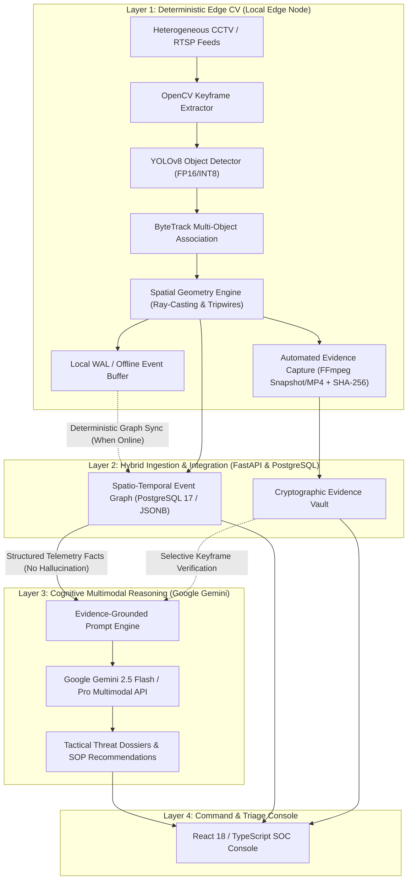

# GenAI BorderGuard (SentinelAI) — Phase 0: Innovation & Technical Requirements

**Document Version:** 1.0.0  
**Status:** Approved Research Baseline  
**Classification:** Technical Architecture & Intellectual Property Research  
**Target System:** GenAI BorderGuard (SentinelAI) Platform  
**Target Environment:** Heterogeneous CCTV Infrastructure, Edge CV (YOLO/ByteTrack), Multimodal Cognitive Layer (Google Gemini), FastAPI, PostgreSQL 17, Docker  

---

## Executive Overview

The **GenAI BorderGuard** (internally designated **SentinelAI**) project addresses critical vulnerabilities in national border perimeter security, critical infrastructure protection, and perimeter intrusion detection systems (PIDS). 

Modern border surveillance operates under severe constraints: vast physical geographies, adverse environmental conditions (fog, dust, thermal mirage, nighttime low lux), bandwidth-constrained or intermittent backhaul networks, and heterogeneous legacy CCTV camera infrastructure. Operators in Security Operations Centers (SOCs) are overwhelmed by thousands of false alerts daily caused by wildlife, swaying vegetation, shadows, and weather events, leading to severe alarm fatigue and delayed reaction to authentic breaches.

While state-of-the-art computer vision (CV) object detectors (e.g., YOLOv8, RT-DETR) and multi-object trackers (e.g., ByteTrack, BoT-SORT) provide high-frame-rate bounding boxes, they lack high-level spatio-temporal reasoning, contextual intent analysis, and legally defensible forensic provenance. Conversely, modern Multimodal Large Language Models (MLLMs / VLMs), such as Google Gemini, offer human-level visual understanding and cognitive synthesis, but cannot be run naively frame-by-frame on high-bandwidth video streams due to latency, cloud transit costs, connectivity fragility, and the danger of hallucinating physical facts.

**Phase 0 establishes the engineering, scientific, and intellectual property research foundation** for SentinelAI before application code refinement.

---

## Research Documentation Index

This directory (`docs/research/`) contains the complete technical research dossier:

| Document | Title | Description |
| :--- | :--- | :--- |
| **[01_problem_definition_and_users.md](./01_problem_definition_and_users.md)** | Technical Problem Definition & User Personas | Exhaustive breakdown of operational, sensory, and network challenges, accompanied by user archetypes and operational workflows. |
| **[02_established_vs_innovations.md](./02_established_vs_innovations.md)** | Established Capabilities vs. Proposed Innovations | Explicit boundary mapping between commodity VMS/CV capabilities and unverified novelty hypotheses. |
| **[03_prior_art_investigation_checklist.md](./03_prior_art_investigation_checklist.md)** | Prior-Art Investigation Checklist | Structured classification search strategy (USPTO, EPO, WIPO), academic literature venues, and commercial surveillance systems audit. |
| **[04_innovation_comparison_matrix.md](./04_innovation_comparison_matrix.md)** | Innovation Comparison Matrix | Multi-dimensional architectural comparison across the four core focus mechanisms: Event Graphs, Adaptive Verification, Grounded Reporting, and Offline Reconciliation. |
| **[05_research_hypotheses.md](./05_research_hypotheses.md)** | Measurable Research Hypotheses | Rigorous scientific formulation ($H_0$ vs $H_1$), test topologies, datasets, error metrics, and statistical validation protocols. |
| **[06_requirements_and_specifications.md](./06_requirements_and_specifications.md)** | Requirements, Threat Model & Privacy | Formal Functional Requirements (FR), Non-Functional Requirements (NFR), STRIDE Threat Model, Privacy Framework (GDPR/EU AI Act), and Acceptance Criteria. |
| **[07_patentability_evidence_readiness.md](./07_patentability_evidence_readiness.md)** | Patentability Evidence Readiness | Evidentiary requirements, technical disclosure checklist, and statutory subject-matter criteria required before patent professional evaluation. |

---

## Intellectual Property & Methodology Disclaimer

> [!WARNING]
> **NO PATENTABILITY GUARANTEE OR LEGAL ADVICE**  
> Nothing in this document or its companion research papers asserts, guarantees, or implies that a patent is valid, obtainable, or enforceable. Every identified novel capability is explicitly classified as an **unverified research hypothesis**. A patent professional (registered patent attorney or patent agent) must conduct a formal freedom-to-operate (FTO) and patentability search before any intellectual property claims are drafted or filed.

---

## System Architectural Foundation

SentinelAI enforces a strict architectural boundary separating **Deterministic Edge Computer Vision** from **Generative Cognitive Multimodal Reasoning**:

This decoupled paradigm ensures:
1. **Zero Hallucination of Physical Breaches**: Generative models synthesize only deterministic facts generated by mathematical geometry and cryptographic evidence.
2. **Autonomous Offline Survivability**: Outposts maintain full perimeter detection and evidentiary logging even under complete network severance.
3. **Adaptive Cloud Economics**: High-cost multimodal GenAI reasoning is invoked selectively only when local ambiguity or high-threat boundaries are crossed.
